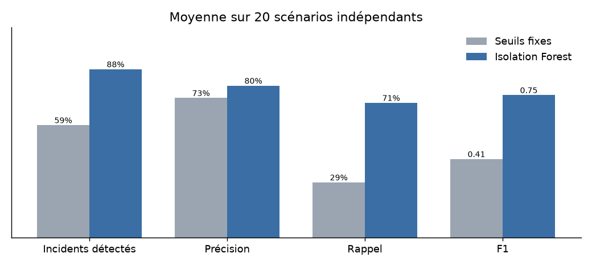
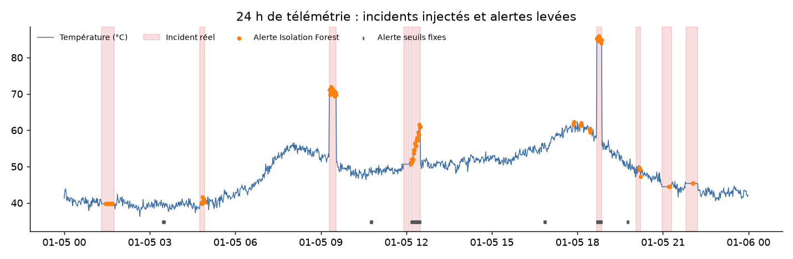

# 🚆 SIV Monitor

> Supervision et **détection d'anomalies par machine learning** sur un Système d'Information Voyageurs (SIV) embarqué ferroviaire simulé.


Un SIV embarqué gère les écrans, les annonces sonores et la localisation GPS d'un train. SIV Monitor simule sa télémétrie (température, charge CPU, ventilateur, alimentation, latence réseau, signal GPS), y injecte des pannes réalistes, puis compare deux façons de les détecter :

| Approche | Principe |
|---|---|
| **Seuils fixes** | Une alerte dès qu'un capteur sort de sa plage (ex. température > 75 °C) — la supervision classique |
| **Isolation Forest** | Un modèle non supervisé qui apprend le fonctionnement normal et repère les comportements inhabituels, y compris quand chaque capteur reste « dans les clous » |

## 📊 Résultats

Moyenne sur **20 scénarios indépendants** (3 jours de télémétrie et ~30 incidents chacun), jamais utilisés pendant la mise au point du modèle :

| Indicateur | Seuils fixes | Isolation Forest |
|---|---|---|
| **Incidents détectés** | 59 % | **88 %** |
| Précision | 73 % | **80 %** |
| Rappel (minutes d'incident signalées) | 29 % | **71 %** |
| F1-score | 0.41 | **0.75** |
| Fausses alertes (par scénario) | 14.7 | **12.4** |



Le modèle détecte **+29 points d'incidents** tout en levant **moins de fausses alertes**. Il réussit notamment là où les seuils échouent :

| Type d'incident | Seuils fixes | Isolation Forest |
|---|---|---|
| Pic de température brutal | 57 % | **100 %** |
| Ventilateur défaillant | 100 % | 100 % |
| Tension d'alimentation qui oscille | 49 % | **90 %** |
| Latence réseau qui se dégrade | 84 % | **99 %** |
| Capteur de température figé | 13 % | **56 %** |



**Limite connue :** un capteur figé reste le plus difficile à repérer (56 %) — en production, on le compléterait par une règle dédiée de « valeur constante ».

> Les chiffres se reproduisent avec `python main.py --benchmark`.

## 🧠 Comment ça marche

1. **Simulation réaliste** (`siv_monitor/simulator.py`) — cycle jour/nuit, heures de pointe, inertie thermique, régulation du ventilateur, et passages en tunnel qui font chuter le GPS *sans être des pannes* (le piège classique des seuils fixes). Cinq types d'incidents étiquetés sont injectés.
2. **Variables construites** (`siv_monitor/detection.py`) — volatilité glissante en échelle log (capteur figé, tension instable), signal GPS lissé, et relations physiques entre capteurs (le ventilateur doit suivre la température, la température doit suivre la charge CPU).
3. **Isolation Forest** — entraîné **sans étiquettes** sur une semaine d'historique ; le seuil de décision est fixé sur cet historique, et une alerte n'est levée que si l'anomalie dure au moins 3 minutes (filtre anti-rebond).
4. **Évaluation** (`siv_monitor/evaluation.py`) — taux d'incidents détectés, précision/rappel/F1 minute par minute, et nombre d'épisodes de fausses alertes.

## 🚀 Lancer le projet

```bash
pip install -r requirements.txt

streamlit run app.py          # dashboard interactif
python main.py                # génère les logs + rapport dans output/
python main.py --benchmark    # compare les deux méthodes sur 20 scénarios
```

Le dashboard propose trois onglets : télémétrie avec incidents et alertes, comparaison seuils vs ML, et journal des alertes exportable en CSV.

## 🧪 Tests

```bash
pip install -r requirements-dev.txt
pytest
```

Les tests (simulation reproductible, règles, évaluation, et vérification que le ML bat les seuils) tournent automatiquement via **GitHub Actions** à chaque push.

## 📁 Structure

```
siv_monitor/
├── simulator.py    # génération de la télémétrie et injection d'incidents
├── detection.py    # seuils fixes + Isolation Forest
└── evaluation.py   # métriques de détection
app.py              # dashboard Streamlit
main.py             # CLI : rapport et benchmark
tests/              # tests pytest
docs/               # figures du README
```

---
Projet réalisé par **Papa Abou Mbaye** — [Portfolio](https://papaabou.github.io/Portfolio) · [LinkedIn](https://www.linkedin.com/in/papa-abou-mbaye-126ab6364)
